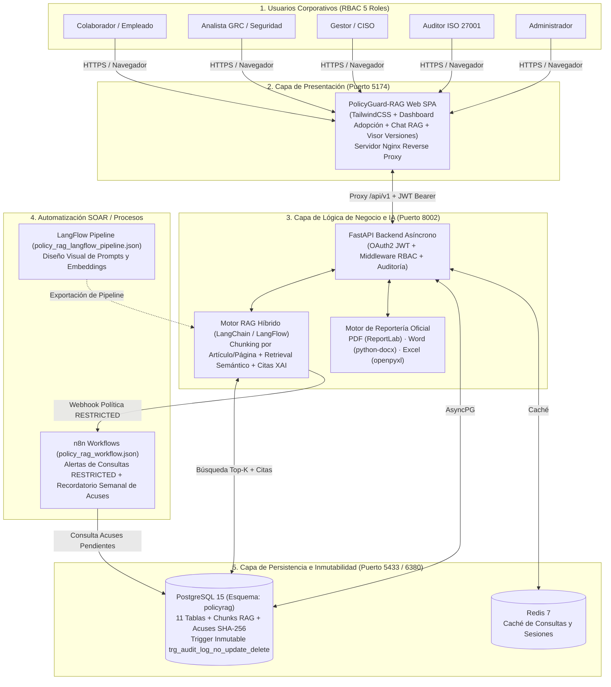

# 01 · Arquitectura, Modelo de Datos y Árbol de Directorios (PolicyGuard-RAG · Caso 21)

## 1. Propósito del Sistema y Vacío de Conocimiento Resuelto
**PolicyGuard-RAG (Caso 21: Gestor de Políticas con Chatbot RAG)** resuelve un problema crítico en seguridad de la información y cumplimiento normativo (**ISO/IEC 27001:2022 Control A.5.1** y **A.6.3**):
- **El Problema:** En las organizaciones, las políticas de ciberseguridad se distribuyen como archivos PDF extensos que los colaboradores rara vez leen o comprenden; el versionado es manual y no existe trazabilidad criptográfica de los acuses de recibo ni métricas de adopción por departamento.
- **La Solución Agéntica:** Una plataforma unificada que automatiza el **versionado y fragmentación (*chunking*) por Artículos y Páginas**, indexa el contenido en **PostgreSQL**, expone un **Asistente Conversacional RAG (LangChain + LangFlow)** que responde dudas citando el **Artículo y Página exacta (Explicabilidad XAI)**, recolecta **Acuses de Recibo con Firma Digital SHA-256**, orquesta alertas en **n8n** y registra toda actividad en una **Bitácora Forense Inmutable con Cadena de Bloques SHA-256**.

---

## 2. Diagrama de Arquitectura en Mermaid



---

## 3. Árbol Completo de Directorios y Programas Contenidos

```text
policy-rag/
├── docker-compose.yml                              # Despliegue en 1 comando (Postgres, Redis, Backend, Frontend)
├── backend/                                        # Capa de Backend API + Motor RAG + Reportería
│   ├── Dockerfile                                  # Imagen Python 3.12 Slim con usuario no-root policyrag
│   ├── requirements.txt                            # FastAPI, AsyncPG, Passlib/Bcrypt, ReportLab, python-docx, openpyxl
│   └── app/
│       ├── __init__.py                             # Paquete principal del backend
│       └── main.py                                 # API v1 completa: Auth, Dashboard, Policies, Ack, RAG, Reports, Audit
├── frontend/                                       # Capa de Presentación Web SPA
│   ├── nginx.conf                                  # Configuración Nginx + Proxy Inverso hacia /api/v1
│   └── dist/
│       └── index.html                              # Aplicación SPA Interactiva (Dashboard, Chat RAG, Políticas, Reportes, Auditoría, RBAC)
├── db/                                             # Capa de Datos PostgreSQL
│   ├── schema.sql                                  # DDL de 11 tablas, índices, cadena SHA-256 y Trigger de Inmutabilidad
│   └── seed.sql                                    # Semilla: 5 roles, 12 permisos, 8 usuarios, 5 políticas ISO 27001, 16 chunks, 22 acuses
├── n8n/                                            # Orquestación de Flujos Automatizados
│   └── policy_rag_workflow.json                    # Flujo n8n de 6 nodos (Webhook, Switch, RAG Verify, Audit, Cron Acuses)
├── langflow/                                       # Diseño Visual de Flujos de IA
│   └── policy_rag_langflow_pipeline.json           # Pipeline LangFlow de 8 nodos (Loader -> Splitter -> Embeddings -> PGVector -> LLM)
└── docs/                                           # Colección Completa de Manuales de Ingeniería
    ├── 01-arquitectura-y-arbol.md                  # Arquitectura Mermaid, Modelo de Datos y Árbol de Directorios
    ├── 02-manual-instalacion.md                    # Manual de Instalación y Despliegue en Docker
    ├── 03-manual-usuario.md                        # Manual de Usuario por Rol y Guía del Chatbot RAG
    ├── 04-manual-errores.md                        # Manual de Errores, Troubleshooting y Guardarraíles XAI
    ├── 05-manual-pruebas.md                        # Manual de Pruebas (Unitarias, Integración, E2E y Trigger Inmutable)
    ├── 06-manual-calidad.md                        # Manual de Calidad del Software (ISO/IEC 25010)
    └── 07-manual-seguridad.md                      # Manual de Seguridad (ISO 27001, OWASP API & LLM Top 10, Blockchain SHA-256)
```

---

## 4. Modelo de Datos en PostgreSQL (`policyrag`)

El esquema relacional consta de **11 tablas normalizadas**:
1. `roles`: Los 5 perfiles del sistema (`admin`, `analista`, `gestor`, `auditor`, `empleado`).
2. `permissions`: Catálogo de 12 permisos granulares `modulo:accion`.
3. `role_permissions`: Matriz M:N entre roles y permisos.
4. `users`: Colaboradores con contraseña `bcrypt` (coste 12), departamento y cargo.
5. `user_roles`: Asignación de roles a usuarios.
6. `refresh_tokens`: Control de sesiones con `jti` UUIDv4.
7. `policies`: Catálogo maestro de políticas (`code`, `title`, `classification`, `iso_control`, `current_version`).
8. `policy_versions`: Historial de versiones con texto Markdown completo y checksum `SHA-256`.
9. `policy_chunks`: Fragmentos indexados por **Artículo** y **Página** con palabras clave y vector de embeddings para el motor RAG.
10. `acknowledgments`: Registro de acuses de recibo con firma digital `SHA-256` única por usuario y versión.
11. `rag_queries` / `audit_log`: Historial de preguntas al Chatbot con sus citas exactas JSONB y bitácora forense inmutable protegida por `trg_audit_log_no_update_delete`.
